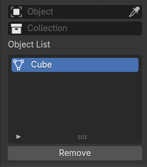
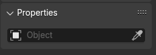
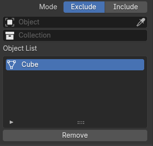

# UI Templates framework

UI Templates ( aka controls ) encapsulate the UI representation and export mechanics for a set of plugin properties. A template could be used with different plugins to provide the same functionality.

A template operates on a set of predefined plugin property types. The specific properties are bound to the template through the plugin description file. A dedicated property type 'TEMPLATE' is used to mark a meta property as a template.

Templates should register a class derived from bpy.types.PropertyGroup which can be instantiated by Blender as a plugin property. This class should provide drawing into a layout and export of the bound plugin properties into a PluginDesc. 

NOTE: Templates are only used for drawing UI in property pages. For drawing node sockets, the same functionality is provided by custom socket classes.

Templates are instantiated and registered at add-on load time. For each template, an function that returns the template's class should be added to plugins/templates/\_\_init__.py. The name of this access function is used in the plugin description to find the template class.

### Generic template description

```json
{
    "Parameters": {
        "attr": "some_property",
        "type": "TEMPLATE",
        "options": {
            "template": {
                "type": "templateAccessFunction",
                "custom_exporter": false,
                "args": {
                    "bound_property": "exclude_list",
                    "another_bound_property": "use_exclude_list", 
                    ... any other properties the template might need
                }
            }
        }
    }
}
```

* `type` is always "TEMPLATE"
* `custom_exporter` set to true to skip the default export procedure and rely on custom export code. This is necessary in order to prevent the default export procedure from overwriting any data exported by the custom export. 
* `template.type` is the name of the access function in templates/__init__.py
* `template.args` is a dictionary of arbitrary values

The registration procedure will always register two properties for each template, which can be used by the template to access its own description in any context:
- `vray_plugin` - the type of the plugin the template is instantiated for.
- `vray_attr` - the name of the template plugin attribute.


## A list of available templates

**NOTE:** See the template class help strings for description of supported template properties.

**NOTE:** Viewport highlight of the selected objects is not a template. All object selectors draw a group of toggle buttons which highlight the selected objects in the 3D viewport (bounding box / tint / x-ray). The highlight stays up until the lit button is clicked again or Esc is pressed, so the scene can be navigated while it is shown. The buttons are drawn by `ui/highlight_objects.py::drawHighlightButtons()`, and the only thing they need from their host is a `getSelectorObjects(context)` method returning the selected objects (or materials, which are resolved to the objects using them). A new selector gets the buttons for free by hosting that call. Objects a tint cannot be built for fall back to a wireframe box, so every selector gets a usable highlight. Lights, empties and cameras report an all-zero `bound_box` and are marked with a fixed-size box at their origin (like the light gizmos in `ui/draw_callbacks.py`); hair, point cloud and volume objects cannot be converted to a mesh and get their real bounding box.

### TemplateMultiObjectSelect 



Selection of multiple scene objects or materials. Both objects and collections can be shown to select from. The list can be filtered to show only the relevant item types. 

**Exports:** a list of objects.



Select a single scene objects or material. The list can be filtered to show only the relevant item types. 

**Exports:** an object.

### TemplateIncludeExcludeList 



A template for selecting multiple scene objects or materials. Based on TemplateMultiObjectSelect, this template adds an Include / Exclude selector.

**Exports:** a list of objects and an include/exlcude flag.

### TemplateSelectGeometries 

NOTE: This is a special template which is designed to be used only in code (as a property type) and does not need a plugin description. Use it as a building block for more complex UI. Example: VRayLight.objectList property


A template for selecting multiple scene objects or materials. Based on TemplateMultiObjectSelect, this template adds an Include / Exclude selector.

**Exports:** not implemented. The host should call template's methods to obtain the export data.


### TemplateFileSelect 


A template that binds to a string property with subtype 'VRAY_FILE_PATH' and adds a File Select button which shows a FileSelect dialog box with file extensions filter.

**Exports:** not implemented. This template only upates the original property.

Properties:
- `bound_property` - name of the string property for which to show the FileSelect dialog.
- `object_type` - the type of the property holder object. Can be one of:
    - shader_node  - for all shader tree nodes and lights without node trees
    - camera
    - settings

### TemplateProxyObjectHierarchy

The contents of a V-Ray Proxy file - which of its objects are rendered, and with what - modelled on the item tree of V-Ray for Cinema 4D.

Drawn in the *Object Hierarchy* rollout of a V-Ray Proxy. Shows the object hierarchy read from the proxy file (.vrmesh / .abc) under a *Visibility* header, with an *Enable* checkbox next to each item, a search field which filters the list as the user types, and a *Reset Object Hierarchy* button which re-reads the file, shows all objects again and drops the material overrides. Toggling a group toggles its whole subtree.

The object names are read by the `vraytools` utility as full '/'-separated paths and stored flattened, in DFS pre-order, in the template's own collection. Reading the file spawns a process, so it never happens while drawing. Normally there is no process to spawn at all: every geometry dump asks the AppSDK for `MESH_ALL`, which already includes `MESH_OBJECTINFOS` and `MESH_SHADERS`, so the tool writes the names into the same `.vrbin` as the preview and `loadVRayProxyPreviewMesh()` hands them to `setObjectNames()`. `rebuild()` — the `-previewType 4` dump, through `plugins/geometry/GeomMeshFile.py::rebuildObjectHierarchy()` — is only for the paths that set the proxy file without loading a preview, which is the `.vrscene` import, plus the *Reset* button and the lazy read below. The shader sets are written on the object-infos entry of the `.vrbin` as well as on the geometry one, so that the `Boxes` and `ObjectList` dumps, which write no geometry, report them too.

Those triggers cannot be complete on their own - a `.blend` saved before this rollout existed has no list at all, and repathing (Find Missing Files, a library remap, moving the `.blend`) changes what the path resolves to without touching the property. So `rebuild()` stamps `sourceFile` with the absolute path it read, and `needsRebuild()` compares that against the current one. When `draw()` finds a list that has never been read for its file it shows "Reading objects from the proxy file..." and queues a one-shot `bpy.app.timers` callback to do the reading, so only a proxy whose panel is actually open pays for it. The stamp is written even when the read fails, which is what keeps a missing file from re-spawning the process on every redraw; *Reset Object Hierarchy* re-reads unconditionally and is the way out of that state.

An unread list is therefore distinguishable from one that was read and found nothing, and only the latter says "No objects in the proxy file".

The rows also carry a `schema` stamp (`_LIST_SCHEMA`). A list stored by an add-on that recorded less than the current one does - schema 0 knows nothing of the shader sets, so none of its rows could carry a material override; schema 1 nothing of which rows have a single child, so it would draw a dropdown on every level of a chain; schema 2 recorded a file with no shader sets as "per object", which it only was vacuously; schema 3 nothing of the materials the slots were imported with, so their rows could not be labelled; schema 4 recorded only their names, which a rename or a purge leaves pointing at nothing - reports `needsRebuild()` and is re-read once through the same timer. That re-read passes `preserveState`, so the check marks and the overrides are carried over by path; *Reset Object Hierarchy* is the one that deliberately discards them. Bump `_LIST_SCHEMA` whenever the reader starts recording something the saved rows cannot hold.

Above the list, a right-aligned dropdown selects between *Exclude* and *Include*, bound directly to the plugin's own `visibility_lists_type` property (the template only reads it, the generic parameter export writes it). The list always holds the **checked** rows and the dropdown says what V-Ray does with them: under *Include* they are the only visible objects, under *Exclude* they are the hidden ones. The check state is therefore membership of the list rather than visibility as such. This is the same split V-Ray for Maya uses - `AttributeAccess::setVisibleNamesList()` exports the ticked names and the AE template draws a separate "Lists type" enum right above the list - and it is what makes the two types differ at all: exporting the complementary set per type instead would describe the same set of visible objects twice, leaving the dropdown with nothing to switch.

The default list type is *Include*, not V-Ray's *Exclude*. A freshly read list has every row checked, which under *Exclude* would hide the whole proxy; as an include list it shows everything, and unchecking a row hides it. The base plugin description declares `visibility_lists_type` as an `INT`, so `GeomMeshFile.custom.json` overrides it as an `ENUM` (its `hair_`/`particle_` siblings already are one) and restates `default` as `"1"`. Overriding the default makes `_mergePluginParam()` record `options.vray_default = 0`, which the `.vrscene` importer restores for scenes that omit the parameter - correct here, and safe because both import paths convert the value to `str` before assigning it to the enum property.

The list-type dropdown is hidden while there is no row for it to act on - with nothing listed, the type is forced to the neutral "exclude nothing" at export time anyway. With no rows at all, only the empty-list label and the *Reset Object Hierarchy* button are drawn.

#### The viewport preview

The preview leaves the hidden objects out too, in three of the four display types. `getVisibilityList()` is the single place the list is decided - the checked object rows and the list type - and both `exportToPluginDesc()` and the preview dump go through it, so what the viewport shows and what V-Ray renders cannot drift apart. The list reaches `vraytools` as `-visibilityList <file>` (one full path per line; a file rather than command-line arguments because a proxy can hold thousands of objects) plus `-visibilityType`, and the tool leaves the hidden objects out of the geometry it writes.

Filtering is applied only once the rows belong to the file being loaded (`needsRebuildFor()`). On a brand new file they have not been read yet, and filtering with the previous file's list would hide objects by a name collision.

**Full**, **Boxes** and **Point** come from a full read, whose object infos carry voxel ranges (`ObjectInfo::vBegin/vEnd`) that index exactly the voxels the read loaded. The geometry is gathered one object at a time and the hidden ones are skipped. That is also what turned `Boxes` and `Point` from a single box (or point) for the whole proxy into one per object, the same thing V-Ray for Cinema 4D shows - it builds its Bounding Box and Point previews from exactly this data, expanding `getGeometryVoxelsBBoxes()` over each object's voxel range (`vray4c4d/source/vray_proxy.cpp`, `getBoundingBox()`).

Splitting the boxes needs the full read, which is a lot to ask of the two display types picked precisely because the proxy is too heavy to draw. `dumpBoxes()` therefore starts with the cheap preview read and takes the full one only when that reports **more than one object**. A single-object file - which is most of the Cosmos library - would get the very same box out of the expensive read, so it keeps the cheap path and its output is unchanged; measured on four heavy Cosmos assets (30-96 MB, all single-object) that is 0.08 s against 0.31-0.82 s. The count is free: the object infos live in the preview voxel, which is why `dumpObjectList()` is nothing but a preview read. Note that the gate is the object count and not the visibility list - a multi-object proxy draws one box per object whether or not anything is hidden, which is both what Cinema 4D does and the only way the display is consistent.

The per-object boxes come straight out of the file's voxel table, which the read does not validate, so they are checked against the `bounds` box the preview read did validate (`boxesWithinBounds()`) and the whole set falls back to that single box if they disagree by orders of magnitude. The same assets that report an unusable box for the preview voxel are what `boxesMatchGeometry()` exists for.

**`Preview`, the default display type, is not filtered.** `Proxy::readPreviewData()` returns the preview voxel as one merged, decimated mesh, and `vBegin/vEnd` index the file's *full* voxel list, which says nothing about that single voxel. The range that does - `VUtils::ObjectInfo::eBegin/eEnd`, the object's face range inside the preview voxel - is in the file, but the AppSDK drops it when it copies the object infos across its C ABI (`VRay::ObjectInfo` carries only `name/id/vBegin/vEnd`), and the symbols that could read it directly live in `meshes_s`, which pulls the whole Alembic reader in behind it - a second static copy of what the runtime `VRaySDKLibrary.dll` already contains. V-Ray for Cinema 4D is an AppSDK client in exactly this position and leaves its preview unfiltered for exactly this reason; the integrations that do filter theirs (3ds Max, Maya, Nuke) are in-process plugins linked against the V-Ray core, so the VUtils mesh API costs them nothing. Switching the display type to `Full`, `Boxes` or `Point` is how to see the list applied in the viewport. The render follows it in every mode.

Regenerating the preview means running `vraytools` over the whole file, which is far too much to spend on a click, so it is not done as the checkboxes are ticked. An *Update Preview* button does it, and the reloads that already happen - a new file, a different preview type or face count, an import - apply the current list on their own.

The anchor points the proxy object's transform is derived from are placed on a box that the dump writes as its own `bounds` entry, separate from `boxes`. It always covers the whole file. `boxes` cannot serve: once it holds one box per *visible* object its first box is the first surviving object's, and anchoring to that would move every proxy in the scene each time something was hidden. For the same reason `_sanitizeBBox()` is skipped for a `bounds` box - it measures the box against the geometry, and a filtered preview is deliberately a subset of what the box bounds. `vraytools` has already run that check over the box it writes.

Hiding everything is a legitimate state, not an error: an empty preview is accepted whenever a list was applied, and the object keeps its position through the anchor points.

#### Convert to Mesh

`vray.proxy_to_mesh` follows the list as well, through the same `getVisibilityList()` and the same `needsRebuildFor()` guard as the preview. Its `FullWithMetadata` dump writes one entry per object out of a full read, so `dumpFullWithMetadata()` skips the hidden ones exactly as `dumpFull()` does - the survivors are counted before the `BinFileWriter`, which writes the entry count into the file as it is constructed. Hidden objects are therefore never serialised, never parsed and never built into Blender meshes. Both hosts that have the list in hand when they convert do the same: Cinema 4D's Make Editable runs `setupProxyCache()`, the same builder that draws its viewport, which skips the sub-objects the list names; Maya's legacy `VRayMesh` bakes the list in with `setVoxelVisibility()` before reading the geometry. (Maya's other importer, `vrayImportVRmeshGeom`, does not filter - but it takes a file path and no node, so it has no list to read.)

What survives the filter does not change the *shape* of the result. The conversion collapses to a single in-place mesh only for a file that holds one object, never because the list happened to leave one standing - C4D allocates its root null and the nulls for each surviving object's path whatever the filter leaves, and only merges for a file with no object infos at all. The file's object count is the row count of the list itself, which is known precisely when the list is applicable. Two edge cases fall out of `_buildProxyHierarchy()` unchanged and match C4D: a group whose whole subtree is hidden produces nothing, because the group Empties are created lazily while walking a surviving object's path; and a hidden object that lies *on* the path of a visible one stays an Empty, because the Empty-to-Mesh replacement only fires when geometry actually arrives for that path.

The list is passed to the tool for every dump, including the one mode that ignores it. Keeping one code path means that if the AppSDK ever carries `eBegin`/`eEnd` across its ABI, only `vraytools` has to change.

#### The shader sets

V-Ray shades a proxy by *shader set*, so that - not the object - is what a material override has to address. Which rows those are depends on the file, and `AlembicMeshFile::initMeshSetsData()` says exactly how:

```cpp
if (useFaceSets && numFaceSets>0) {
    for each face set j:  addMaterialID(id++, objectName [+ '/'] + faceSetName);
} else {
    // Register unique material entry for each voxel/object
    addMaterialID(id++, objectName);
}
```

`buildHierarchyRows()` therefore puts the shader sets into the same tree as the objects, placed by their names:

* a name that **is** an object merges onto that object's row - an Alembic object with no face sets is its own shader set, which is most Alembic files;
* a name that **extends** an object becomes a child row of it, labelled with the remainder (`inside_up` under `/ABC_Exporter/blast20/blast20`) - the owner is found by longest-prefix match, which is how the name was composed in the first place;
* a name that resembles no object becomes a row of its own - every `.vrmesh` shader set, since `DefMeshFile` overrides neither `setUseFaceSets()` nor `setUseFullNames()` and its names are the ones baked in when the file was written, or `mtl1`, `mtl2`, … synthesised from the material IDs by `DefaultMeshSetsData::addMaterialID()`.

Whether **every** shader set fell into the first case is what `perObjectMaterials()` reports. It decides how the overrides are exported (below), and it decides the shape of the UI.

#### The lists

Each row also records the OR of the types below it (`branchTypes`), and that is what says which control the row can offer: the *Enable* checkbox on objects and the groups above them (`canToggleVisibility()`), a material on shader sets and the groups above them (`canOverrideMaterial()`). Those two predicates are also the two lists over the rows - `VRAY_UL_ProxyVisibility` and `VRAY_UL_ProxyShaderSets` are two filters over the one `items` collection, each drawing the rows it has a control for, through the shared `_filterRows()`. One collection is what keeps the DFS pre-order that the group cascade, the material inheritance and the export all rely on.

* **Where the shader sets are the objects** there is one list, and each row carries its own material in a dropdown at its right edge. `canToggleVisibility()` excludes nothing in this mode, so the list is the whole tree; a row the file gives no shader set of its own - an Alembic instance shares the one of the object it was cloned from - gets an empty cell instead of a dropdown, so the column stays lined up.
* **Where they are not**, no row of the visibility list can carry a material, so it has no material column at all and a second list below it holds them. The bare shader set rows are not in the visibility list: they stand for nothing that can be shown or hidden. That second list is a tree rather than a flat list of sets, because the objects and groups above them are in it too - a material there covers every shader set below it, and the closest one to a set wins.
* **Where the file defines no shader sets at all** - `cube.vrmesh`, and every Cosmos `.vrmesh` that registers no material IDs - nothing in the hierarchy can carry a material, and `perObjectMaterials()` is False rather than vacuously true. What the proxy is shaded with is then the object's material slots, so the second area is `VRAY_UL_ProxyMaterialSlots` over `object.material_slots` with `active_material_index` - the object's own collection, not the template's, which is how Blender's Material Properties panel draws them and keeps the two selections in step. A row is `<index>: <material name>`, or `<index>:` for an empty slot, with the slot's material dropdown on the right. The index leads because it is what the faces of the proxy carry, and the name is the material the slot was **created with**, not the one it holds now: the row stands for a shading group of the asset, and reading the label off the slot would make it stop naming that group the moment the dropdown next to it moved. What the slots came with is captured when they are created, by `captureImportedSlots()` through `import_file.py::_captureImportedProxySlots()`, from both places that create them - `_assignMaterialsToSlots()`, which the `.vrscene` importer also uses, and `_addMaterialSlotsForProxyShaders()`. Each entry holds the material **and** the name it had then: the name is the label and is frozen, so a rename does not move it, while the material is a pointer, so it survives one and, counting as a user, is still there to go back to after the user has assigned over every slot. That is the baseline *Reset Object Hierarchy* puts the slots back to: the rebuild drops the overrides the rows carried, and `restoreSlotMaterials()` does the same job for the slots, assigning each its imported material - `None` both for a slot that came in empty and for one whose material has since been deleted from the blend outright. It restores the materials and not the slot array: a slot added by hand past the end of the snapshot is left alone (and, having no recorded name, falls back to labelling itself with the material it holds), and one the user deleted is not re-created. That half of *Reset* runs in every mode and not only in this one, which is the only mode that draws the slots: they hold the proxy's shading whichever of the two lists the rollout draws over the rows, and the button's tooltip says it puts them back. `setObjectNames()` takes the snapshot too, but only for a proxy imported before any of this existed, where the slots as they stand are all there is to go on; it never re-takes one that is already there, or *Reset* would restore whatever the user last set. `_captureImportedProxySlots()` skips anything that is not a V-Ray Proxy, since `_assignMaterialsToSlots()` also runs for the ordinary meshes of a `.vrscene` import, whose `GeomMeshFile` is never drawn. Those slots are the importer's - built from the shader sets, or for a Cosmos asset from the `ids_list` of the material file's `MtlMulti` (`_assignMaterialsToSlots()`) - and an assignment there is the slot itself, so this case needs no export path of its own: it is already what `_exportObjMaterials()` turns into the `ids_list` `MtlMulti`. The object is found by `_getSlotOwner()`, which prefers `context.object` and falls back to any object using the mesh, since a Properties editor pinned to the mesh leaves `context.object` unset.

Each list sits under a header of its own - *Visibility*, which also carries the include/exclude dropdown at its right edge, and *Materials* below it, whichever of the two the file calls for - with a `separator(type='LINE')` between the two areas when both are drawn. Each is drawn only when it has a row, so a file with no object infos but with shader sets shows the shader sets alone instead of an empty box above them, and a proxy with no slots gets no slot area. The material slots are the exception to "only when there are rows": they do not come from the file, so they are drawn even for a list with no rows in it, below the "No objects in the proxy file" label. The two row lists keep their own selections (`activeItem`, `activeShaderSet`), both indexing the same collection, and share `expanded`.

A row's disclosure triangle keys off having children *in that list* (`hasChildrenInList()`) rather than off `isGroup`: in the visibility list an object whose only children are its face sets is a leaf, and a triangle on it would reveal nothing. Its material dropdown is subject to one more rule (`showsMaterial()`): a group with a single child in that list does not get one. Whatever it were given would reach that child and nothing else, and the child carries a dropdown anyway - so a chain of one-child groups (`/objects` → `pSphere1` → `pSphereShape1`, or the `/ABC_Exporter/blast20` above a pair of face sets) offers the assignment once, at the level where it means something. A row that is a shader set itself always gets one: no child stands in for its own set. `buildHierarchyRows()` counts the children per list into `soleChildTypes` rather than leaving `draw_item()` to walk the subtree on every redraw.

A bare shader set is labelled with the remainder of its name after the object it belongs to (`inside_up`), which is what makes the second list readable - the full name is that object's path with the face set name stuck on the end. Exporters do give every object's face set the same name (`Max_MaterialID_0`), and there the owner is no longer the row above, so `buildHierarchyRows()` names it on the labels that would otherwise collide: `Max_MaterialID_0 (Teapot001Shape)`. Two sets under one owner with the same remainder would be one name and have already been folded together, so this always tells them apart. Only `name` is affected, never `fullPath` or `shaderId`.

Each row's material dropdown is an ID selector, so it accepts a material dragged onto it from the Outliner or the Asset Browser through Blender's own `UI_OT_drop_name`. It is the dropdown and not the row that is the target, and that is forced: Blender exposes no drop target API for a `template_list` (the C++ one is bound to the newer `AbstractView` grid/tree views, which have no Python bindings) and no way to tell which row the cursor is over.

The Scene Lister's *Assign Material* is a drop the lists **can** take, because it is not a Blender drag at all. It is a pickup (`ui/lister/assign_drag.py`): the first click picks a material up, a preview follows the cursor, and the next click drops it - in the viewport onto whatever a raycast finds. A list row is not something a raycast can find, so the rollout offers Blender's own hit testing instead: while a pickup is in progress `_drawLabel()` draws the row's **name** as an operator button, and `VRAY_OT_proxy_hierarchy_drop_material` behind it calls `dropPickedUpMaterial()` to take the material and end the pickup. This works precisely because a panel button fires on mouse **release**, which is the release that ends the drop - the same timing the module's own "NOTE on drag" turns to its advantage. All three lists get it. The operator's `target` says which one drew the row: the two hierarchy lists are views of one collection, so the index means the same in both and only the selection to move differs, while `SLOT` indexes the object's material slots instead and is found through the `vrayProxySlotOwner` context pointer rather than `vrayProxyHierarchy`. A drop also **selects** the row it landed on - `activeItem`, `activeShaderSet` or `active_material_index` - as a click on it would have done, in the list that drew it, since the other may not be showing that row. A row with no dropdown - one with no shader set of its own, or a group in front of a single child - is not a target, since it has no material to set. The material is taken before the row is resolved, so a drop onto a row that a *Reset* has removed between the press and the release still ends the pickup instead of stranding the modal with no way out but Esc.

The name is the target rather than the material dropdown, which is left exactly as it is: the dropdown keeps working during a pickup, and nothing in the lists changes until a drop actually lands. Nor does the name visibly change. `emboss=False` leaves the widget background undrawn (`interface_widgets.cc:2653`) and a left-aligned sub-row makes the button hug its text, so what is left is the name and its icon where the label drew them - a plain `UI_BTYPE_BUT` would otherwise centre its text, since `interface.cc:4378-4390` hands `UI_BUT_TEXT_LEFT` to `UI_BTYPE_LABEL` and not to it. What the button adds is the hover brightening every button gets (`widget_state()`, `interface_widgets.cc:2645`, which applies whatever the emboss), and that is the drop target marking itself out under the cursor one row at a time.

The pickup modal consumes mouse events, which would swallow the click before the button ever saw it, so it passes **everything outside a 3D viewport** straight through - one test, `self._hoverRV3D is None`, since only a viewport region leaves that set. The release is included, without which the button would never fire, and so is the mouse move: Blender activates the button under the cursor only while handling `MOUSEMOVE` (`ui_handle_button_over`), and a button that was never activated ignores the click that follows, so swallowing the move would break the drop even though the click itself got through. Passing everything on also leaves the lists scrollable and expandable while aiming. The relay modal covering the other windows uses the same test, so the two now behave identically.

The cost of the simpler gate is that **a click outside a viewport no longer cancels the pickup** - anywhere, not just over this rollout. It goes to whatever is underneath and the pickup runs until a drop or Esc.

The cursor swatch follows the pointer over the Properties editor too - the pickup is one mode wherever the cursor is, and losing the swatch at the edge of the viewport would read as it having ended. `_SWATCH_EDITORS` says where, and it is purely a drawing concern now that nothing routes events by editor type: it is where `_updateHover()` tracks a region, where `_tagHoverRedraw()` repaints, and which space types `_draw()` is registered on (`SpaceProperties` as well as `SpaceView3D`, since a draw handler is per space type - `_finish()` removes each from the space it was added to). A region that is tracked and one that is not behave identically for events; the difference is only whether the swatch can be drawn there. The hint line under the material name changes to suit - there is no new slot to add on a list row - and the whole block mirrors to the left of the cursor when it would run off the right of a narrow editor, measured with `blf.dimensions()`.

Both the swatch and the paintbrush cursor are shown only where a drop would land: over a viewport, or over a list that takes one. `_listUnderCursor()` asks `bpy.context.ui_list` with the hovered region overridden onto the context - Blender's own hit test, `screen_ctx_ui_list()` at `screen_context.cc:1127` calling `UI_list_find_mouse_over()` - and `_updateCursor()` drops the cursor back to `DEFAULT` away from one, pushing it only when it changes rather than on every mouse move. A list is as fine as this gets: Blender exposes no hit test for a single widget, so the cursor can be narrowed to the list but not to the one row's name inside it, and Blender's hover brightening on the name is what closes that last gap.

Which lists take a drop is not fixed, and this is the reason `setListTakesDrop()` is called from each `draw_item()` rather than declared once at registration. It is a property of what the list is drawing, not of the list: **the visibility list carries a material only in the per-object case**, so for every `.vrmesh` - which is every Cosmos asset, none of which registers shader sets - it has no material column and therefore no drop target at all, and the materials go on the object's slots instead. Registering it statically would have the pickup wear its cursor over a list that cannot take what it is carrying. The shader set list and the slot list always have somewhere for a drop to land and pass `True`. `_noteDropTargets()` both records this and returns whether the rows should draw as targets at all, which is what puts the pickup test on the list rather than on every cell.

**Exports:** `use_full_names` = 1 and `visibility_list_names` = the full paths of the checked objects. The names have to be produced with the same settings V-Ray renders with, hence `use_full_names`. `visibility_lists_type` is not written by the template - it is exported from its own property, which is what the dropdown edits. The one exception is a list with no object rows in it (no file yet, no object info channel, or a failed read): an empty *Include* list would mean "hide the whole proxy" with nothing in the UI to explain it, so the export then forces `visibility_lists_type` = 0, the neutral behaviour the plugin had before the template existed. Unchecking every row by hand is a different case and is left alone - hiding everything is then exactly what was asked for.

The material overrides reach V-Ray one of two ways, chosen by `perObjectMaterials()`. In both, the resolution itself is the tree: a row's override is its own or the closest ancestor's, which is how a material set on a group covers its branch and how a leaf beats the group it sits in. In the face-set case that resolution is `_resolveMaterials()`, one forward pass over the pre-order rows with a stack of the ancestors carrying a material - an ancestor walk per row instead re-reads the whole prefix of the collection for a row at depth 0, and in a `.vrmesh`, whose shader sets resemble no object, every one of them is.

**Per object** - `exporting/node_export.py::_exportProxyMaterialOverrides()` wraps the proxy's own material in an `MtlMulti` with `use_shader_set_patterns` = 1 and a `shader_sets_list` of object-path patterns: `<path>` for a row the file gives a shader set of its own, `<path>/*` for every row so that the rule covers the branch below it, with a trailing `*` falling back to the proxy's material. V-Ray matches those against the shader set name of the shaded point, which in this mode *is* the object path. Both patterns are emitted for a row that is an object and a parent at once (object names `/a` and `/a/b`): the set named after it exactly is matched by neither `/a/*` nor anything below. The first matching rule wins, so they are ordered by the **depth** of the row, deepest first, and only then by length. Length alone is not enough - a group's `/a/*` and its child's `/a/b` are the same string length, so the group would outrank its own child whenever a path segment is a single character, while a descendant is always strictly deeper than its ancestor. A non-empty `shader_sets_list` makes `MtlMulti` ignore `ids_list` entirely, which is why this wraps the slot-based material rather than replacing it - and why the wrapped plugin is tracked against the object here: what the node exporter tracks is the plugin it is handed, which from here on is the wrapper.

**Face sets** - `_applyProxyMaterialOverrides()` replaces the material of slot `shaderId` in the per-slot list before the usual `ids_list` `MtlMulti` is built, so the override wins and every other set keeps its slot material. The names cannot be used here: the tool reads them as V-Ray builds them at `use_face_sets` 1, while at 2 a `/` is inserted and a literal pattern would miss. The IDs are the same either way - `initMeshSetsData()` runs the same `id++` loop and only the string changes - and a shader set's ID is also the material ID of the faces V-Ray shades with it, hence the index of the slot `_addMaterialSlotsForProxyShaders()` created for it on import.

A proxy is in exactly one mode, so the two never meet in one `MtlMulti`. Neither writes `use_face_sets`. Both are skipped when a geometry node has collapsed the object to a single slot (`_getProxyCollapsedMaterialSlot()`), since the index space is then no longer the shader sets'.

**Limitation:** in the face-set case the granularity is per shader set, not per object - objects sharing a set cannot be shaded apart, and 3ds Max and Maya have the same limitation for the same reason. The UI makes it visible rather than accepting an override that cannot fire: the visibility list carries no material at all in that mode, and what a material can be set on is exactly what the *Materials* list shows.

Properties:
- `file_property` - name of the string property holding the path to the proxy file. Defaults to `file`.
- `mode_bound_property` - name of the enum property holding the include/exclude mode. Defaults to `visibility_lists_type`.

### TemplateColorTemperature

A template for selecting between RGB color and color temperature in V-Ray lights.

**Exports:** the color value. If in Temperature mode, the color is derived from the temperature Kelvin value.

Properties:
- `color_mode` - name of the enum property for selection between Color ('0') and Temperature ('1').
- `color_bound_property` - name of the color property (usually a COLOR_TEXTURE meta-property) to update.
- `temperature_bound_property` - name of the float property for the temperature value in Kelvin.


 